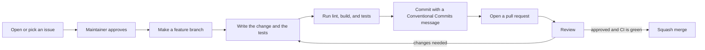

# Contributing

Thank you for your interest in llm-gauntlet. This file explains how to set up Windows, how the workflow works, how to open a pull request, and how to review one.

Status: Build parts P01 to P33 are built. Some commands below work only after the build part that adds them. Read `docs/PLAN.md` for the build order.

All commands in this file are PowerShell commands.

## Before you start

Read these files:

- `README.md` for the purpose and the risk section.
- `docs/ARCHITECTURE.md` for the components.
- `docs/DECISIONS.md` for the decisions. Do not change a decision without approval.
- `CONVENTIONS.md` for the code style and the rules.
- `docs/SECURITY.md` for the security rules.
- `CODE_OF_CONDUCT.md` for the behavior that we expect.

If you use an AI coding agent, read `AGENTS.md` first.

## Rules that never change

- Never commit a secret. This includes cookies, tokens, keys, API keys, and real session files.
- Never use a real account in a test. Use mock adapters.
- Never add code that bypasses a CAPTCHA, a rate limit, or a usage limit.
- Never add code that hides the automation from a provider.
- Never store a password.
- Never change a system setting, a registry key, or a machine-wide policy.
- Keep all Windows code in `src/platform/windows/`.

A pull request that breaks one of these rules gets closed.

## What you can work on

- **A build part.** The parts are in `docs/PLAN.md`. Each part is one logical change and one commit.
- **A bug fix.** Open an issue first if the bug is not already known.
- **A documentation fix.** Fix a mistake, a missing step, or an unclear sentence.
- **A new provider adapter.** Read `docs/PROVIDERS.md`. Open an issue first.
- **A port to Linux or macOS.** Read `docs/PORTING.md`. Open an issue first.

Do not start a large change without an issue. Wait for the maintainer to approve the issue. This saves your time.

A change that is not in `docs/PLAN.md` needs approval first. A change that adds a dependency needs approval first. A change to the database schema needs approval first, after part P11.

## Set up Windows

### What you need

- Windows 10 or Windows 11.
- PowerShell 7 or Windows PowerShell 5.1. PowerShell 7 is the better choice.
- Node.js (current LTS version).
- Git.
- Microsoft Edge. It is already on Windows 10 and Windows 11.
- A GitHub account.

### Get the code

1. Fork the repository on GitHub. Use the Fork button on the page `https://github.com/JatinSri1909/llm-gauntlet`.
2. Clone your fork. Replace `<your-user-name>` with your GitHub user name.

   ```powershell
   git clone https://github.com/<your-user-name>/llm-gauntlet.git
   cd llm-gauntlet
   ```

3. Add the main repository as `upstream`.

   ```powershell
   git remote add upstream https://github.com/JatinSri1909/llm-gauntlet.git
   ```

4. Run the setup script.

   ```powershell
   .\setup.ps1
   ```

   If PowerShell blocks the script, run the wrapper. It changes the execution policy for that one run only.

   ```powershell
   .\setup.cmd
   ```

   The setup script asks before it installs a tool. It does not change any system setting.

5. Check the setup.

   ```powershell
   npm run build
   npm run lint
   npm test
   ```

   All three commands must pass before you start.

### Tips for Windows

- **Line endings.** Do not change `core.autocrlf` for this repository. The file `.gitattributes` sets the line endings. PowerShell scripts use CRLF. Source files and Markdown files use LF.
- **Long paths.** Keep the clone near the root of a drive if you see path length errors. Example: `C:\dev\llm-gauntlet`.
- **File locks.** Antivirus software and editors can lock files. If a test fails with an `EBUSY` or `EPERM` error, close programs that use the folder and run the test again.
- **Data folder.** The application uses `%LOCALAPPDATA%\llm-gauntlet`. Tests use a temporary folder and never touch your real data folder.
- **Editor.** Use an editor that respects `.editorconfig`.

## Workflow



### 1. Pick an issue

Pick an issue or open a new one. Say in a comment that you work on it. This stops two people from doing the same job.

### 2. Update your fork

```powershell
git switch main
git fetch upstream
git merge --ff-only upstream/main
git push origin main
```

### 3. Make a feature branch

Make one branch for each change. Use a short name with a type and a topic.

```powershell
git switch -c feat/usage-tracker
```

Branch name types: `feat`, `fix`, `docs`, `test`, `refactor`, `chore`, `ci`.

### 4. Write the change

- Keep the change small. One pull request is one logical change.
- Follow `CONVENTIONS.md`.
- Write tests for the change. Tests use mock adapters and fake services.
- Update the docs if the change affects them.
- Mark a feature that does not exist yet as "Planned" in the docs. Do not describe a feature that does not exist.
- Do not add a dependency that is not in `docs/PLAN.md`.

### 5. Check the change

Run these commands. All of them must pass.

```powershell
npm run lint
npm run build
npm test
```

Also look at your change before you commit it.

```powershell
git status
git diff
```

Check that the change holds no secret and no file that you did not mean to add.

### 6. Commit

Use the Conventional Commits format.

```text
<type>(<scope>): <short summary>

<body, if needed>
```

Rules for the message:

- The type is one of `feat`, `fix`, `docs`, `test`, `refactor`, `chore`, `ci`, or `build`.
- The scope is the area of the code. Examples: `cli`, `decision`, `store`, `platform`, `providers`.
- The summary is in the imperative mood. It has no full stop at the end. It is 72 characters or fewer.
- The body says why you made the change, not only what you changed.
- Write `BREAKING CHANGE:` in the body if the change breaks existing behavior.

Examples:

```text
feat(usage): add rolling window request counter
fix(platform): retry atomic rename on EBUSY
docs(providers): add snapshot sanitising steps
```

```powershell
git add <files>
git commit
```

Add the files by name. Do not use `git add .` if you did not check `git status` first.

### 7. Push and open a pull request

```powershell
git push origin feat/usage-tracker
```

Then open a pull request from your branch to `main` of the main repository.

## Open a pull request

Use the pull request template. It asks for these items:

- What the change does and why.
- The issue or the build part that the change belongs to.
- The checks that you ran.
- The docs that you updated.
- A confirmation that the change holds no secret and uses no real account.

Rules for a pull request:

- The title uses the Conventional Commits format. The project uses squash merge, and the title becomes the commit message.
- One pull request is one logical change. If your change needs more than one commit of different kinds, split it into more than one pull request.
- Keep the pull request small. A small pull request gets a faster review.
- Say if a part of the change is a guess or is not tested.
- Do not push to a pull request branch after approval without a comment that says what changed.
- Answer review comments. Mark a comment as resolved only after you fix it or agree on another way.

The CI workflow runs lint, build, and tests on `windows-latest`. A pull request needs a green run to merge.

## Review a pull request

Anyone can review. You do not need to be a maintainer. One approval from a maintainer is required to merge.

### How to review

1. Read the issue or the build part first. Then read the pull request description.
2. Read the diff in small steps.
3. Run the change if you can.

   ```powershell
   git fetch origin pull/<number>/head:pr-<number>
   git switch pr-<number>
   npm ci
   npm run lint
   npm run build
   npm test
   ```

   Replace `<number>` with the pull request number. When you finish, go back to your own branch.

   ```powershell
   git switch main
   git branch -D pr-<number>
   ```

4. Use the checklist below.
5. Write clear comments. Say what is wrong and why. Offer a fix if you can.
6. Choose "Approve", "Comment", or "Request changes".

### Review checklist

**Rules**

- The change holds no secret, no cookie, no token, and no real session file.
- The change uses no real account in a test.
- The change adds nothing that bypasses or hides anything on a provider site.
- The change adds no dependency that is not in `docs/PLAN.md`.
- The change adds no package that needs a native build.
- The change does not edit a decision in `docs/DECISIONS.md` without approval.
- Windows code is only in `src/platform/windows/`.
- The setup script changes no system setting.

**Quality**

- The change is one logical change.
- The code follows `CONVENTIONS.md`.
- Names are clear. Functions are short.
- Error cases have a clear message and a typed error.
- Paths are built with the Node.js `path` module.
- Logs hide secrets.

**Tests**

- The change has tests.
- Tests fail if the code is wrong. A test that cannot fail is not a test.
- Tests pass on Windows.
- Tests use mock adapters and fake services.

**Docs**

- The docs match the code.
- A planned feature is marked "Planned".
- The text uses short sentences, the active voice, and the same terms as the other docs.

**Snapshots** (adapter changes only)

- Each snapshot is sanitised. Read `docs/PROVIDERS.md`.
- A second person has checked the snapshot.

### How to give feedback

- Be kind and be clear. Review the code, not the person.
- Mark a small style point as "nit". It does not block a merge.
- Ask a question if you do not understand a choice. The author may have a reason.
- Say what is good. Praise helps.

### How to merge

A maintainer merges after these items are true:

- One maintainer approved the pull request.
- The Windows CI run is green.
- All review comments are resolved.
- The title follows Conventional Commits.

The maintainer uses squash merge.

## Report a bug

Open an issue with the bug report template. Include:

- What you did.
- What you expected.
- What happened.
- The Windows version, the PowerShell version, and the Node.js version.
- The output of `gauntlet doctor`, after part P32 exists.

Do not include a session file, a key, a cookie, or a token. Remove secrets from logs before you paste them.

For a security problem, do not open a public issue. Read `docs/SECURITY.md`.

## Work with the maintainer on build parts

For the build parts in `docs/PLAN.md`, the maintainer works in this order:

1. One part at a time, in the order of the plan.
2. One commit for each part.
3. The application builds and the tests pass after each part.

If you want to take a part, comment on its issue first. Do not start a part before the earlier parts that it needs are merged.

## Questions

Open a discussion or an issue with the question label. Ask in plain words. No question is too small.