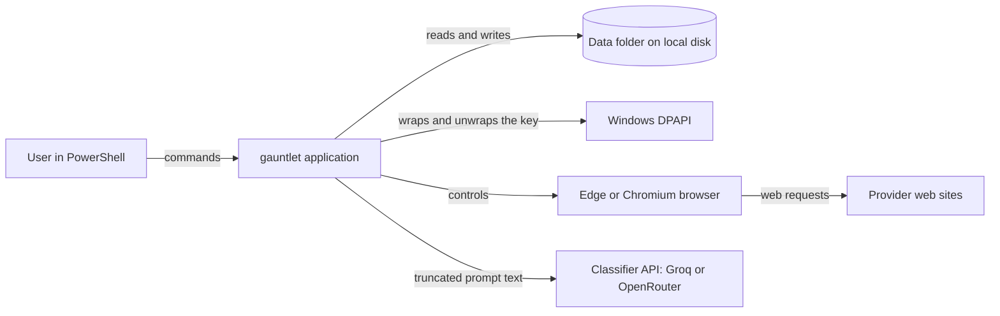
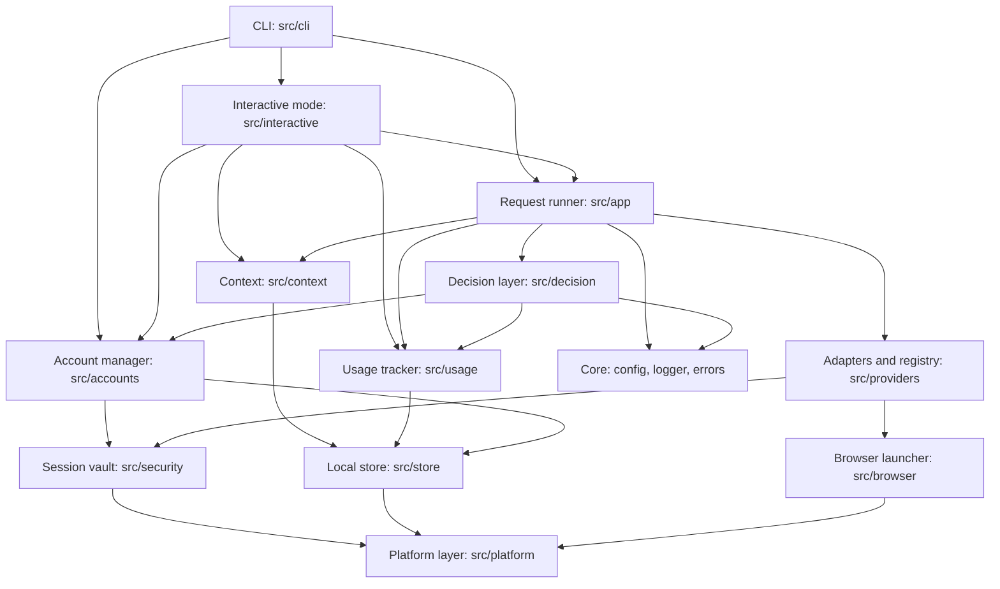
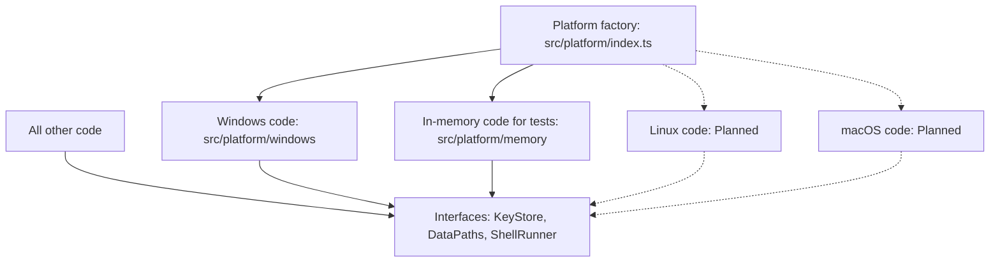
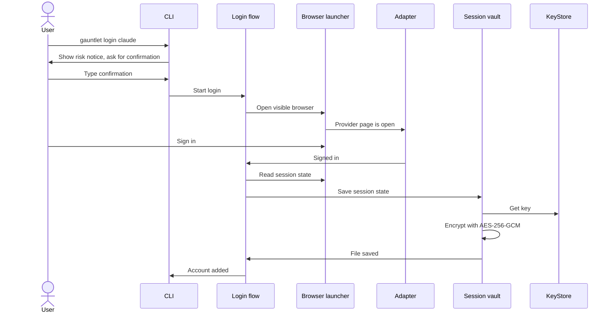
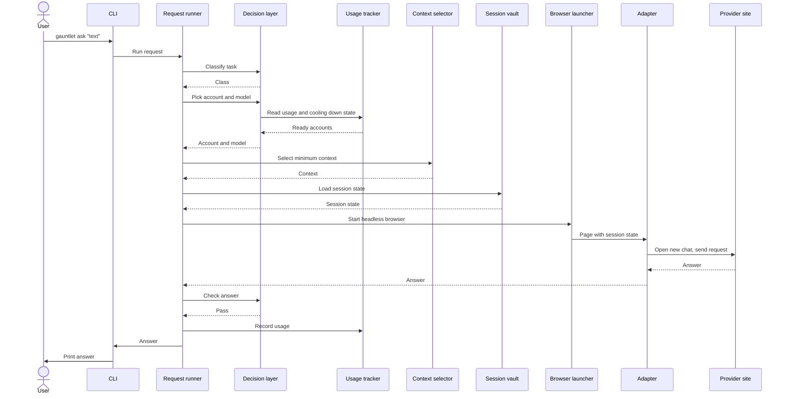
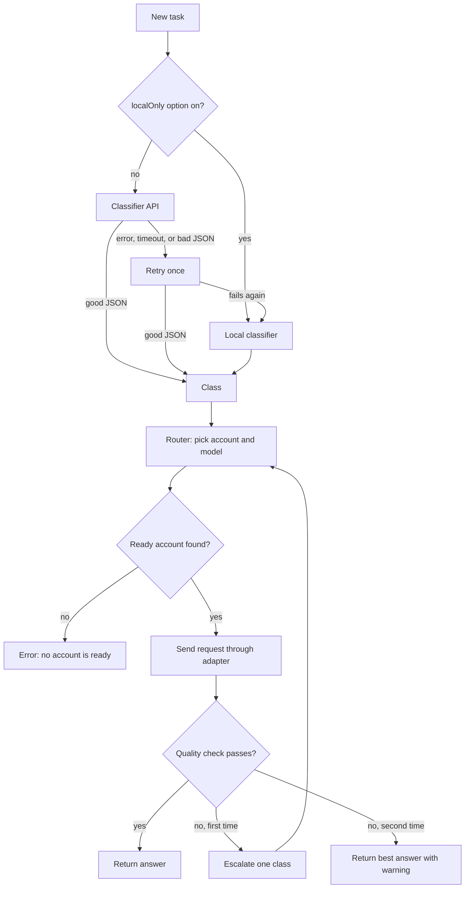
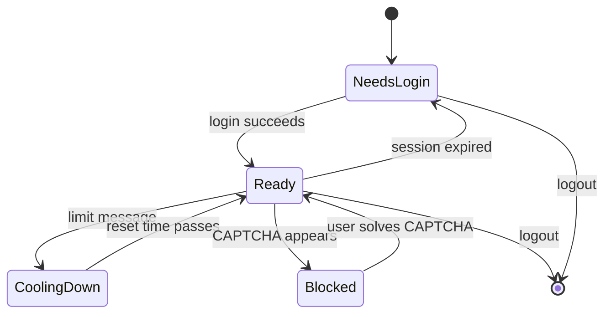
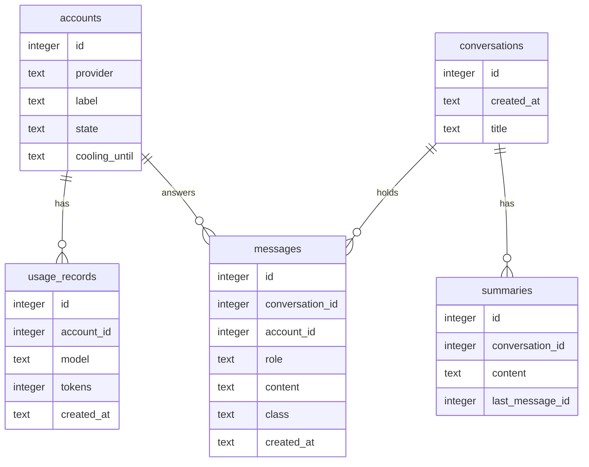
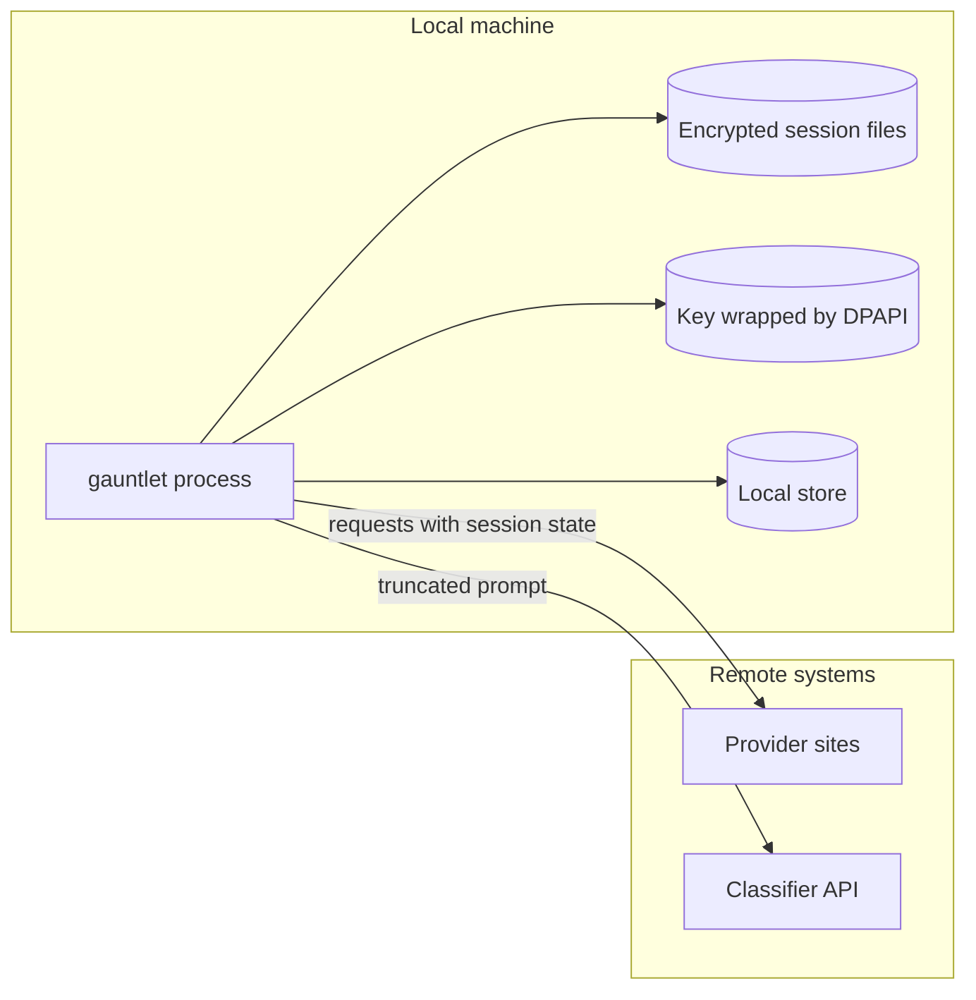

# Architecture

This file describes the components of llm-gauntlet and the data flow between them.

Status: Planned. The code does not exist yet. This file describes the design for version 1. Read `docs/PLAN.md` for the build order.

## Terms

Each term has one meaning in all files.

| Term | Meaning |
| --- | --- |
| Provider | An AI platform. Examples: Claude, ChatGPT, Kimi, DeepSeek, z.ai. |
| Account | One free account of the user on one provider. |
| Adapter | The code that controls one provider through the browser. |
| Session state | The saved browser state of one account. It holds cookies and local storage. It never holds a password. |
| Session vault | The component that encrypts and decrypts session state. |
| Decision layer | The components that classify a task, pick an account, and check the answer. |
| Class | The difficulty of a task. The classes are `simple`, `standard`, and `hard`. |
| Local store | The SQLite database. It holds conversations, messages, summaries, and usage records. |
| Data folder | The folder `%LOCALAPPDATA%\llm-gauntlet`. |
| Cooling down | The state of an account that reached a limit. The application does not use the account until the reset time. |
| Classifier API | A free API (Groq or OpenRouter) that classifies a task. |
| Interactive mode | The prompt that opens when the user runs `gauntlet` with no arguments. The user types a task or a slash command. |
| Slash command | An input in interactive mode that starts with `/`. Example: `/usage`. |

## Design rules

- The application keeps all data on the local machine.
- The application stores session state only. It never stores passwords.
- The application uses headless mode for all work except login.
- The application sends the minimum context.
- The application selects the cheapest model that can do the task.
- The application never bypasses a CAPTCHA, a rate limit, or a usage limit.
- All Windows-specific code is in `src/platform/windows/`. No other folder calls a Windows API.
- Each component hides its details behind an interface. Tests replace the real component with a fake.

## System context

The diagram shows the application and the systems around it.



The classifier API is optional. The `localOnly` option turns it off.

## Components

The diagram shows the components and their dependencies.



### Component list

| Component | Folder | Job |
| --- | --- | --- |
| CLI | `src/cli` | Parse commands. Start interactive mode when there are no arguments. Show the risk notice. |
| Interactive mode | `src/interactive` | Read the prompt. Run slash commands. Show a spinner and a status line. Print answers. |
| Request runner | `src/app` | Run one request from the start to the end. |
| Decision layer | `src/decision` | Classify the task. Pick the account and the model. Check the answer. Escalate. |
| Context | `src/context` | Save messages and summaries. Select the minimum context. |
| Usage tracker | `src/usage` | Count requests and tokens. Set the cooling down state. |
| Account manager | `src/accounts` | Add, list, and remove accounts. Run the login flow. |
| Adapters and registry | `src/providers` | Control one provider. Find an adapter by name. |
| Browser launcher | `src/browser` | Start Edge or Chromium. Use visible mode or headless mode. |
| Session vault | `src/security` | Encrypt and decrypt session state. Store secrets. |
| Local store | `src/store` | Open the database. Run migrations. |
| Platform layer | `src/platform` | Hide the operating system. Hold the interfaces `KeyStore`, `DataPaths`, and `ShellRunner`. |
| Core | `src/core` | Read config. Write logs without secrets. Define typed errors. |
| Doctor | `src/doctor` | Run the self checks. |

## Platform layer

The platform layer is the only place that knows the operating system.



- The factory picks the code from `process.platform`.
- On Linux and macOS, the factory throws an error that says the platform is "Planned".
- A later port adds a new folder and a new factory case. It changes no other code. Read `docs/PORTING.md`.

## Data flow: login

The user runs `gauntlet login <provider>`. In interactive mode, the user types `/login <provider>`. Both ways use the same login flow.



If the provider shows a CAPTCHA, the adapter signals `CaptchaRequired`. The flow stops. The CLI asks the user to solve the CAPTCHA in the visible window.

## Data flow: ask

The user runs `gauntlet ask "<text>"`. Interactive mode sends each task through the same flow.



The runner saves the request, the answer, and the usage records in the local store.

## Data flow: interactive mode

The user runs `gauntlet` with no arguments.

```mermaid
sequenceDiagram
    actor User
    participant Shell as Interactive mode
    participant Runner as Request runner
    participant Use as Usage tracker
    participant Flow as Login flow

    User->>Shell: gauntlet
    Shell->>User: Show prompt
    User->>Shell: Task text
    Shell->>User: Show spinner
    Shell->>Runner: Run request in the current conversation
    Runner-->>Shell: Answer, class, account label, model
    Shell->>User: Print answer and status line
    User->>Shell: /usage
    Shell->>Use: Read usage records
    Use-->>Shell: Records
    Shell->>User: Print records
    User->>Shell: /login claude
    Shell->>Flow: Start login flow
    Flow-->>Shell: Account added
    Shell->>User: Show prompt
    User->>Shell: /exit
    Shell->>User: Close
```



Rules for interactive mode:

- Input that starts with `/` is a slash command. All other input is a task.
- An unknown slash command gives an error. It sends nothing to a provider.
- Interactive mode keeps one conversation for each run. `/new` starts a new conversation. `/resume` loads an earlier conversation from the local store.
- Interactive mode and `gauntlet ask` use the same request runner. They use the same classifier, router, and quality check.
- Interactive mode shows a spinner. It prints the whole answer when the answer arrives. Streaming answers are Planned.
- Interactive mode prints one status line after each answer. The line shows the class, the account label, and the model. `/verbose` shows more detail about the routing choice.
- Interactive mode turns off colors and the spinner when the output is not a terminal or when `NO_COLOR` is set.
- If a CAPTCHA stops a request, interactive mode prints the message that asks the user to solve it in a visible window. Then it shows the prompt again.
- Interactive mode uses the Node.js built-in `readline` module. It adds no package.

## Decision layer

The decision layer has four jobs.



### Classifier

- The classifier API receives only the truncated prompt text. It receives no history and no account data.
- The classifier API must return JSON. The code checks the JSON with a schema.
- If the API fails, the code retries once. Then it uses the local classifier.
- The local classifier uses rules. It never calls the network.

### Router

- The router reads the class, the usage records, and the model map in the config.
- The router picks the cheapest model that fits the class.
- The router skips an account that is cooling down.
- If an account fails, the router picks the next ready account.
- If no account is ready, the router returns an error. It never waits in a loop.

### Quality check

- The local checks look for an empty answer, a cut-off answer, and a refusal pattern.
- For `standard` and `hard` tasks, the classifier API can also score the answer.
- A failed check escalates the task one class, once.
- After the second failure, the runner returns the best answer with a warning.

## Account states



- `Blocked` means that a CAPTCHA stopped the work. The application never solves a CAPTCHA.
- `CoolingDown` ends only at the reset time. The application never tries to get around a limit.

## Local store

The local store is one SQLite database in the data folder. It uses the built-in `node:sqlite` module. Read decision D6 in `docs/DECISIONS.md`.



- The table `settings` holds key and value pairs. The table `messages_fts` is the FTS5 index of the message text.
- The database holds no session state and no secret. Session state is in encrypted files.
- The first commit of the schema is part P11. After that commit, a schema change needs approval.

## Data folder

```text
%LOCALAPPDATA%\llm-gauntlet\
    gauntlet.db            Local store
    config.json            Settings
    sessions\              One encrypted file for each account
    keys\                  The key, wrapped by DPAPI
    logs\                  Logs without secrets
```

- The code builds each path with the Node.js `path` module.
- The file code retries on `EBUSY` and `EPERM` errors. This handles file locks and antivirus delays.
- The file code writes a temporary file and then renames it. This keeps a file whole if a crash occurs.
- The file code handles the Windows long path limit.

## Security boundaries



- Session state leaves the machine only inside requests to its own provider site.
- The classifier API receives the truncated prompt. The first run shows a notice about this.
- The key is random. DPAPI wraps the key for the current Windows user. Another user cannot unwrap it.
- The application passes the key to the PowerShell helper through stdin. It never passes the key as an argument.
- The logger hides secrets. Read `docs/SECURITY.md`.

## Failure handling

| Failure | Response |
| --- | --- |
| The classifier API fails | Retry once. Then use the local classifier. |
| The classifier API returns bad JSON | Retry once. Then use the local classifier. |
| A provider shows a limit message | Set the account to cooling down. Pick the next account. |
| A provider shows a CAPTCHA | Stop. Ask the user to solve it in a visible window. |
| The session expired | Set the account to needs login. Pick the next account. |
| No account is ready | Return an error. Do not wait in a loop. |
| The answer fails the quality check | Escalate one class, once. Then return the best answer with a warning. |
| A file is locked | Retry with a short delay. Then return an error. |
| The key cannot be unwrapped | Return an error. Do not delete any file. Tell the user to run `gauntlet doctor`. |

## Folder map

```text
llm-gauntlet/
    setup.ps1
    setup.cmd
    src/
        cli/            Commands
        interactive/    Prompt, slash commands, status line
        app/            Request runner
        decision/       Classifier, router, quality check, escalation
        context/        Context store and selector
        usage/          Usage tracker
        accounts/       Account manager and login flow
        providers/      Adapter interface, registry, mock, claude
        browser/        Browser launcher
        security/       Session vault, secret store
        store/          Database and migrations
        platform/       Interfaces and factory
            windows/    All Windows code
            memory/     In-memory code for tests
        doctor/         Self checks
        core/           Config, logger, errors
    tests/
    docs/
```

## Extension points

| To add | What to do |
| --- | --- |
| A provider | Write an adapter. Register it. Read `docs/PROVIDERS.md`. |
| A platform | Add a folder in `src/platform/`. Add a factory case. Read `docs/PORTING.md`. |
| A slash command | Add a handler in `src/interactive/commands/`. Add a test. |
| A class | Change the classifier, the model map, and the tests. This needs approval. |

## Planned changes

- A background process that keeps the browser open between requests. Status: Planned.
- Embeddings for context search. Status: Planned.
- A full-screen interface built with Ink. Status: Planned.
- Streaming answers. Status: Planned.
- Linux and macOS support. Status: Planned.