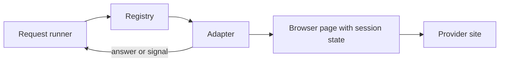

# Providers

This file explains how to write a provider adapter for llm-gauntlet.

Status: Planned. The code does not exist yet. This file describes the design for version 1. Part P14 updates this file when the adapter interface is built. Read `docs/PLAN.md` for the build order.

## Terms

| Term | Meaning |
| --- | --- |
| Provider | An AI platform. Examples: Claude, ChatGPT, Kimi, DeepSeek, z.ai. |
| Adapter | The code that controls one provider through the browser. |
| Registry | The list of adapters. The registry finds an adapter by name. |
| Session state | The saved browser state of one account. It never holds a password. |
| Signal | A typed result that tells the application about a special event. The signals are `LimitReached`, `CaptchaRequired`, and `SessionExpired`. |
| Selector | A rule that finds one element on a provider page. |
| Snapshot | A saved and sanitised copy of a provider page. Tests use snapshots. |
| Mock adapter | An adapter that returns scripted results. All tests use it. |

Read `docs/ARCHITECTURE.md` for the other terms.

## Provider status

| Provider | Adapter | Status |
| --- | --- | --- |
| None | Mock adapter | Planned for version 1 (part P15) |
| Claude | Claude adapter | Planned for version 1 (part P20) |
| ChatGPT | ChatGPT adapter | Planned (part L1) |
| Kimi | Kimi adapter | Planned (part L2) |
| DeepSeek | DeepSeek adapter | Planned (part L3) |
| z.ai | z.ai adapter | Planned (part L4) |

## What an adapter does

An adapter has a small job. It does these steps for one provider:

1. It checks that a page is signed in.
2. It sends one request in a new provider chat.
3. It waits for the answer and reads it.
4. It reports a signal if the page shows a limit message, a CAPTCHA, or a signed-out page.

An adapter does not choose an account. An adapter does not choose a model class. An adapter does not store data. The decision layer, the usage tracker, and the local store do these jobs.



## The adapter contract

Every adapter follows the same contract. Part P14 writes the TypeScript interface. The table shows the planned operations.

| Operation | Input | Result |
| --- | --- | --- |
| `name` | None | The provider name. It is lowercase. Example: `claude`. |
| `models` | None | The models that the adapter can pick, in order from cheapest to most capable. |
| `loginUrl` | None | The page that the visible browser opens for login. |
| `isSignedIn` | A browser page | `true` if the page shows a signed-in account. Otherwise `false`. |
| `send` | A browser page, a model, and the request text | The answer text, or one signal. |

Rules for the contract:

- An adapter receives a browser page. It never starts a browser. The browser launcher starts the browser.
- An adapter returns a signal as a typed result. It never throws an error for a limit message, a CAPTCHA, or a signed-out page.
- An adapter throws a typed error only for a real failure. Examples: the page layout changed, or the page timed out.
- An adapter never reads or writes a file. The session vault does that.
- An adapter never calls the network by itself. It acts only through the browser page.

## Signals

| Signal | When the adapter returns it | What the application does |
| --- | --- | --- |
| `LimitReached` | The page shows a usage limit or rate limit message. The signal holds the reset time if the page states it. | The usage tracker sets the account to cooling down. The router picks the next account. |
| `CaptchaRequired` | The page shows a CAPTCHA or a human check. | The application stops. It asks the user to solve the CAPTCHA in a visible window. |
| `SessionExpired` | The page shows a sign-in screen. | The application sets the account to needs login. The router picks the next account. |

## Rules for every adapter

- **Never bypass a control.** Do not solve a CAPTCHA. Do not get around a rate limit or a usage limit. Do not use a hidden endpoint to read a quota.
- **Never add stealth code.** Do not hide the automation. Do not fake a user agent. Do not add random mouse moves to look like a human.
- **Use headless mode.** The adapter works in headless mode. Only the login flow uses the visible browser.
- **Send one request at a time.** The runner controls the pace. The adapter does not send two requests to one account at the same time.
- **Open a new chat for each request.** Do not continue a provider thread. Read decision D15.
- **Send the text that the runner gives.** Do not add text. Do not remove text.
- **Never log a secret.** Do not log cookies, tokens, or the page content. Use the logger of the application. It hides secrets.
- **Wait for a state, not for a fixed time.** Wait for an element or a page state. Do not use a fixed sleep as the main wait.
- **Use clear timeouts.** Every wait has a time limit. A timeout is a typed error.
- **Keep all selectors in one file.** Put the selectors in `selectors.ts` in the adapter folder. A layout change then needs a change in one file.

## Folder layout

Each adapter has its own folder in `src/providers/`.

```text
src/providers/
    types.ts                    The adapter contract and the signals
    registry.ts                 The list of adapters
    mock/
        mock-adapter.ts         The scripted adapter for tests
    <provider>/
        <provider>-adapter.ts   The adapter
        selectors.ts            All selectors of the provider pages
tests/
    fixtures/<provider>/        Sanitised page snapshots
    <provider>-adapter.test.ts  The adapter tests
```

## How to add a provider

Use these steps in this order. Each build part is one commit.

1. **Open an issue.** Name the provider. Link the terms of service of the provider. Say if the provider allows automated access. Wait for approval from the maintainer. A new provider is a new part in `docs/PLAN.md`.
2. **Copy the folder layout.** Make `src/providers/<provider>/` with an adapter file and a `selectors.ts` file.
3. **Write the snapshots.** Save the provider pages that the adapter needs. Sanitise each snapshot. Read the next section.
4. **Write the tests first.** Serve the snapshots from a local server. Test the sign-in check, the send flow, the answer read, the limit detection, and the CAPTCHA detection.
5. **Write the selectors.** Put them in `selectors.ts`.
6. **Write the adapter.** Follow the contract and the rules in this file.
7. **Register the adapter.** Add it to `registry.ts`.
8. **Add the models.** Add the models to the model map in the config defaults, from the cheapest to the most capable.
9. **Update the docs.** Change the status in the table in this file and in `README.md`. Do not mark the adapter "Done" until the manual check passes.
10. **Run the manual check.** The maintainer signs in with a real account. The maintainer sends one request. This check is not part of the test suite. No test uses a real account.
11. **Open a pull request.** Use the pull request template. List the checks that you did.

## How to sanitise a snapshot

A snapshot can hold secrets and personal data. Do this before you commit a snapshot:

1. Save the page after you sign in with a test account that holds no private data.
2. Remove all `<script>` content that holds tokens or user data.
3. Remove cookies, local storage values, and any header values.
4. Replace names, email addresses, and account identifiers with fake values.
5. Replace chat history with short fake text.
6. Search the file for your email address, your name, and the words `token`, `session`, `bearer`, and `key`.
7. Ask a second person to review the snapshot before the pull request merges.

Never commit a snapshot that you did not sanitise. A reviewer must reject it.

## How to test an adapter

- Tests use the mock adapter for everything outside the adapter itself.
- The adapter tests use snapshots that a local test server serves. They never open a real provider site.
- Each adapter has tests for these cases:
  - A signed-in page returns `true` from `isSignedIn`.
  - A signed-out page returns `false` and `send` returns `SessionExpired`.
  - A normal send returns the answer text.
  - A page with a limit message returns `LimitReached`, with the reset time if the page states it.
  - A page with a CAPTCHA returns `CaptchaRequired`.
  - A page with a changed layout throws a typed error that names the missing selector.
  - A page that never answers ends with a timeout error.
- A test must pass on Windows. Use the Node.js `path` module for every path.

## The mock adapter

The mock adapter is part P15. It returns scripted results. A script can return an answer, a limit message, a CAPTCHA signal, a signed-out signal, or a failure. Tests for the router, the usage tracker, the quality check, and interactive mode use it.

## What to do when a provider changes its page

A provider can change its page at any time. The adapter then fails. This is normal.

1. The adapter throws a typed error that names the missing selector.
2. The application shows a clear message. It does not retry in a loop.
3. A contributor saves a new snapshot, updates `selectors.ts`, and updates the tests.
4. A reviewer checks that the change touches only the files of that adapter.

## Review checklist

A reviewer checks these points for each adapter pull request:

- The provider terms are linked in the issue.
- The adapter follows the contract.
- The adapter has no code that bypasses or hides anything.
- All selectors are in `selectors.ts`.
- Snapshots are sanitised.
- Tests use no real account.
- Tests pass on Windows.
- The docs show the correct status.
- The pull request touches no file outside the adapter, the registry, the tests, the config defaults, and the docs.